# Catalog data model (P0.11)

The target schema for the rebuild's catalog, scoring and pipeline data. Phase 2 turns it into migrations, split by domain as in PLAN Phase 2. Size estimates are in [BUDGET.md](BUDGET.md).

**Inputs:**
- `docs/legacy/SCHEMA.md` (legacy schema);
- `docs/legacy/CATALOG_REVIEW.md` (what to keep);
- [SOURCES.md](SOURCES.md) (approved sources and their key fields; owner decisions D-013);
- CLAUDE.md "Catalog and data rules".

**Contents**
1. [Conventions](#1-conventions)
2. [ER diagram](#2-er-diagram)
3. [Tables](#3-tables)
4. [Views](#4-views)
5. [Raw data storage and retention](#5-raw-data-storage-and-retention)
6. [Rule checklist](#6-rule-checklist-claudemd--schema)
7. [SOURCES.md key fields → schema](#7-sourcesmd-key-fields--schema)
8. [Legacy tables → new tables](#8-legacy-tables--new-tables)
9. [Open points](#9-open-points)

---

## 1. Conventions

### 1.1 Identifiers
- **Entities** (companies, brands, products, stores, documents …) use `id uuid primary key default gen_random_uuid()`.
- **High-volume rows** use `id bigint generated always as identity` to save 8 bytes per row and per index entry. These are price rows, events, logs, candidates, queue items, receipt lines, citations and entity links.
- Every **stable natural key** gets a unique constraint. Natural keys are the import keys; the surrogate `id` is never used as an import key.

| Thing | Stable key | Rule |
|---|---|---|
| Company | `slug` (unique), plus `wikidata_qid` (unique, nullable) | Slug rules in §1.3. |
| Brand | `slug` (unique), plus `wikidata_qid` (unique, nullable) | §1.3. |
| Product | `gtin` (unique, nullable), plus `(source_id, external_id)` (unique) | GTIN normalized to 14 digits (§1.4). |
| Secondary product code | `(scheme, value, coalesce(banner_id, nil))` | Store SKU, PLU, alternate GTIN. |
| Store | `(osm_type, osm_id)` when known, else `(banner_id, external_store_id)`, else `slug` | Open Prices locations are OSM-keyed. |
| Store listing | `(banner_id, external_sku)` when the SKU is known, else `(banner_id, listing_key)` | `listing_key` = normalized name + size text. |
| Price observation | `(source_id, external_id)` | E.g. the Open Prices price id. |
| Document | `url_normalized` (unique) | Lower-case host; strip fragment, `utm_*` and tracking parameters. |
| Category | `slug` (unique, path-like, e.g. `dairy/milk/plant-based`) | |
| Source | `key` (unique, e.g. `off`, `open-prices`, `wikidata`) | Matches SOURCES.md S-ids (§3.1). |

### 1.2 Provenance columns (the "prov" block)

Every table that holds a **fact** carries these columns (CLAUDE.md "Provenance"):

| Column | Type | Notes |
|---|---|---|
| `source_id` | uuid not null → `sources` | Where the fact came from. Manual edits use the `manual` source. |
| `source_url` | text null | The exact URL of the fact. It may be null **only** when `sources.url_template` plus `external_id` rebuilds it exactly (e.g. OFF product pages). The view `*_with_source_url` (§4) exposes the computed URL. This saves about 50 bytes on each of 95k products. |
| `fetched_at` | timestamptz not null | When the source was read, or when the fact was entered (manual). |
| `method` | text not null | One of `import` (bulk dump), `api`, `ai`, `manual`, `legacy-import`, `receipt`, `derived` (computed rollup). There's no `scraper` value until a scraper source is approved (D-013). |
| `method_version` | text not null | Pipeline job name and version (`off-import@1.0.0`); AI model plus prompt and rubric version (`openrouter:google/gemini-2.5-flash-lite\|score@3\|rubric@v1`); `manual@admin-ui`. |
| `ingestion_run_id` | uuid null → `ingestion_runs` | Null for manual and receipt facts. |
| `raw_object_id` | uuid null → `raw_objects` | The stored raw response that this fact was parsed from (`on delete set null`, because files expire). |

Facts that an AI produced also carry `ai_call_id` → `ai_calls`. Rows also get `created_at` / `updated_at` with a trigger, as in legacy.

Admin edits to a field that an import also writes add the field name to the row's `locked_fields text[]`. Imports skip locked fields. Each edit writes an `audit_log` row (old → new, actor, time) with `method = manual`.

### 1.3 Slugs (companies, brands, categories, banners)
- **Build:** NFKD-normalize, drop accents, lower-case, `&` → `and`, apostrophes dropped, every other non-`[a-z0-9]` run → `-`, trim `-`, at most 64 characters. Example: "Ben's Original" → `bens-original`.
- **Collision:** append the country code (`-ca`, `-us`), then `-2`, `-3` …
- **Stability:** a slug never changes after creation. A renamed company keeps its slug, and its old names go in `aliases`. A merge sets `status = merged` plus `merged_into_id`, and the old slug keeps resolving.
- A check constraint enforces the pattern `^[a-z0-9]+(-[a-z0-9]+)*$`.

### 1.4 GTIN rule
- Digits only. Validate the check digit. Store as **GTIN-14**: UPC-A gets `00` prepended, EAN-13 gets `0`, EAN-8 gets six `0`s.
- A bad check digit is a validation failure; it is never stored as a GTIN.
- Restricted-circulation prefixes are stored in `product_identifiers` with scheme `store_internal` (banner-scoped), not as a GTIN. That covers GS1 prefixes 02 and 20–29 (variable-weight and in-store codes).
- PLU codes (4–5 digits) use scheme `plu`.
- The function lives in `packages/core/src/gtin.ts` (moved forward to P2.10, D-030) and is mirrored as an immutable SQL function for lookups.

### 1.5 Review status

Facts that need review carry:
- `review_status`: `pending` | `approved` | `rejected` | `superseded`;
- `reviewed_by` uuid null → `profiles`, and `reviewed_at`;
- `decision_method`: `admin` | `auto` | `legacy`.

Public RLS shows only `approved` rows. `auto` means the row passed a rule written in PLAN or DECISIONS (for example the P4 auto-accept threshold, or a future D-006 score rule). Legacy-imported facts arrive as `pending` (P0.2 quality notes).

### 1.6 RLS levels (every table has RLS enabled)

| Level | Read | Write |
|---|---|---|
| **public** | `anon` + `authenticated`, filtered to `approved` / active rows where the table has a status | admin only (`is_admin()`) |
| **owner** | the row's `user_id = auth.uid()` | the owner (insert/update/delete as listed) |
| **admin** | `is_admin()` only | `is_admin()` only |

Pipeline jobs run on GitHub Actions with the service-role key (Actions secret only, D-003), so they bypass RLS. No client ever holds that key (D-005).

---

## 2. ER diagram

Relationships only. Columns are in §3.

```mermaid
erDiagram
  sources ||--o{ ingestion_runs : "runs"
  ingestion_runs ||--o{ raw_objects : "stores"
  ingestion_runs ||--o{ ingestion_run_events : "logs"
  ingestion_runs ||--o{ validation_failures : "rejects"

  companies ||--o{ company_ownership : "parent of"
  companies ||--o{ company_ownership : "child in"
  companies ||--o{ brand_ownership : "owns"
  brands ||--o{ brand_ownership : "owned via"
  brands ||--o{ products : "brands"
  categories ||--o{ categories : "parent of"
  categories ||--o{ products : "classifies"
  categories ||--o{ category_mappings : "maps"
  products ||--o{ product_identifiers : "has codes"
  products ||--o{ product_sources : "contributed by"

  companies ||--o{ banners : "operates"
  banners ||--o{ stores : "has"
  banners ||--o{ store_listings : "lists"
  products |o--o{ store_listings : "matched to"
  stores ||--o{ price_observations : "priced at"
  products |o--o{ price_observations : "for"
  store_listings |o--o{ price_observations : "as listed"
  stores ||--o{ price_points_weekly : ""
  products ||--o{ price_points_weekly : ""
  products ||--o{ price_points_monthly : ""
  categories |o--o{ reference_prices : "benchmarks"
  categories ||--o{ price_sanity_bounds : "bounds"

  rubrics ||--o{ company_scores : "version"
  companies ||--o{ company_scores : "scored"
  ai_calls |o--o{ company_scores : "produced"
  company_scores ||--o{ score_citations : "cites"
  documents ||--o{ score_citations : "cited in"
  documents ||--o{ document_entities : "mentions"
  companies |o--o{ document_entities : ""
  brands |o--o{ document_entities : ""
  companies |o--o{ certifications : ""
  brands |o--o{ certifications : ""
  documents |o--o{ certifications : "evidence"
  companies ||--o{ external_ratings : ""
  companies ||--o{ company_events : ""
  documents |o--o{ company_events : "evidence"
  products ||--o{ product_features : ""
  products ||--o{ transparency_steps : ""
  companies |o--o{ stories : ""

  match_candidates }o--|| review_queue : "may raise"

  profiles ||--o{ scans : ""
  profiles ||--o{ receipts : ""
  stores |o--o{ receipts : "at"
  receipts ||--o{ receipt_lines : ""
  store_listings |o--o{ receipt_lines : "printed as"
  products |o--o{ receipt_lines : "matched to"
```

---

## 3. Tables

Each table lists its columns, its keys, and its **RLS** level. "+prov" means the §1.2 block; "+review" means the §1.5 block.

### 3.1 Pipeline bookkeeping

**`sources`**: one row per source in SOURCES.md that we use, plus the internal sources `manual`, `legacy-import`, `receipts` and `derived`. RLS: **public** read for every column, admin write (D-031: every column mirrors the public SOURCES.md, so no secrets go here). The `source_attributions` view gives the attribution UI its fields.

| Column | Type | Notes |
|---|---|---|
| `id` | uuid | |
| `key` | text unique | E.g. `off`, `open-prices`, `statcan-18100245`, `wikidata`, `wikipedia`, `sec-edgar`, `corp-canada`, `gdelt`, `rss-cbc-business`. |
| `sources_md_id` | text null | `S1` … `S30`. |
| `name`, `homepage_url` | text | |
| `licence`, `licence_url`, `attribution_text` | text | E.g. ODbL + "Contains data from Open Food Facts …". |
| `access_method` | text | `bulk_dump`, `api`, `rss`, `manual`. |
| `terms_url`, `terms_checked_at` | text, date | From SOURCES.md. |
| `verdict` | text | `use` / `manual_only` / `avoid`. Jobs refuse to run unless `use`. |
| `url_template` | text null | E.g. `https://world.openfoodfacts.org/product/{external_id}` (§1.2). |
| `rate_limit_per_sec` | numeric | ≤ 1 by default (CLAUDE.md). |
| `refresh_interval` | interval | Freshness policy (Phase 6). |
| `enabled` | bool | |

**`ingestion_runs`**: one row per pipeline run. RLS **admin**.

`id` uuid · `source_id` · `job` text (`off-import`) · `job_version` text · `mode` (`full` | `delta` | `sample` | `dry_run`) · `sample_size` int null · `status` (`running` | `completed` | `completed_with_errors` | `failed` | `cancelled`) · `started_at`, `finished_at` · `triggered_by` (`schedule` | `dispatch` | `cli`) · `git_sha` · `actions_run_url` · `counts` jsonb (`fetched`, `valid`, `invalid`, `inserted`, `updated`, `unchanged`, `skipped_locked`) · `expected_total` int null (so capped pagination is caught, per review lesson 3) · `dump_url`, `dump_sha256`, `dump_fetched_at` (bulk sources, D-010) · `error_summary`.

A run left in `running` past its timeout is marked `failed` by the next run's start-up sweep (replaces legacy heartbeats).

**`ingestion_run_events`**: bigint id · `run_id` · `at` · `severity` · `event_type` · `message` · `details` jsonb. **At most 50 rows per run** (enforced by the driver), deleted after 30 days. RLS **admin**.

**`raw_objects`**: one row per stored raw file. RLS **admin**.

`id` uuid · `source_id` · `run_id` · `storage_path` (`raw/{source_key}/{run_id}/{seq}.json.gz`) · `content_sha256` · `byte_size` · `content_type` · `request_url` · `http_status` · `fetched_at` · `expires_at` · `deleted_at` null. The row stays after the file is deleted, with `deleted_at` set, until the run itself ages out.

**`validation_failures`**: records rejected before writing (CLAUDE.md "Validation before writing"). RLS **admin**.

bigint id · `run_id` · `raw_object_id` · `record_key` (e.g. the GTIN) · `rule` (`required_field`, `gtin_check_digit`, `price_sanity`, `unit_parse`, `duplicate`, `schema`) · `message` · `payload` jsonb (trimmed to ≤ 1 KB) · `created_at`. At most 50 per run; the run's `counts.invalid` holds the full number. 30-day retention.

### 3.2 Ownership

**`companies`**: RLS **public** (`status <> 'rejected'`).

| Column | Type | Notes |
|---|---|---|
| `id`, `slug` | uuid, text unique | |
| `name`, `legal_name` | text | |
| `aliases` | text[] | Old names, other spellings. |
| `kind` | text | `company`, `cooperative`, `government`, `individual`, `nonprofit`. |
| `country` | char(2) | |
| `headquarters`, `founded_year`, `ownership_type` (`public`/`private`/`state`/`coop`), `stock_ticker`, `website`, `description`, `logo_url` | | Legacy profile fields. `logo_url` links to Wikimedia Commons; logos aren't stored in Supabase. |
| `ceo`, `revenue_range` | text null | Legacy fields. Volatile, so `locked_fields` / audit applies. |
| `wikidata_qid` | text unique null | S17. |
| `wikipedia_title`, `wikipedia_revision_id` | text, bigint | S19. |
| `sec_cik` | text unique null | S20. |
| `corp_canada_number` | text null | S21. |
| `opencorporates_id` | text null | `jurisdiction/number`. Filled from Wikidata P1320 when present; S22 itself is avoided. |
| `status` | text | `active`, `defunct`, `merged`, `rejected`. |
| `merged_into_id` | uuid null | |
| `locked_fields` | text[] | §1.2. |
| +prov | | |

**`company_ownership`**: parent → child edges between companies. RLS **public** (`approved` only).

`id` uuid · `parent_company_id` · `child_company_id` (check: parent ≠ child) · `relation` (`subsidiary`, `majority_stake`, `minority_stake`, `joint_venture`, `division`) · `share_pct` numeric(5,2) null · `valid_from` date null · `valid_to` date null · `confidence` numeric(3,2) · +review · +prov.

Unique on `(parent_company_id, child_company_id, relation, coalesce(valid_from, '-infinity'))`. Cycles are rejected by a trigger (recursive check).

**`brands`**: RLS **public**.

`id` uuid · `slug` unique · `name` · `aliases` text[] · `wikidata_qid` unique null · `website` · `logo_url` · `description` · `is_private_label` bool (e.g. President's Choice) · `status` · `merged_into_id` · `locked_fields` · +prov.

Trigram GIN expression index on `normalize_match_text(name)`.

**`brand_ownership`**: brand → company. Ownership is its own mapping, never a product column (CLAUDE.md). RLS **public** (`approved` only).

`id` uuid · `brand_id` · `company_id` · `relation` (`owner`, `licensee`, `private_label_of`) · `valid_from`, `valid_to` date null · `confidence` numeric(3,2) · `match_candidate_id` bigint null (the resolver decision that created it) · +review · +prov.

Unique on `(brand_id, company_id, relation, coalesce(valid_from,'-infinity'))`. At most one current (`valid_to is null`, `approved`) `owner` row per brand, enforced by a partial unique index.

### 3.3 Products

**`products`**: the one product table (D-008). RLS **public** (`status = 'active'`).

| Column | Type | Notes |
|---|---|---|
| `id` | uuid | |
| `gtin` | char(14) unique null | Primary barcode (§1.4). Null for loose produce and unbarcoded items. |
| `external_id` | text not null | The id in `source_id` (the OFF `code`, or a manual id). Unique `(source_id, external_id)` makes imports idempotent. |
| `name` | text not null | |
| `brand_id` | uuid null → `brands` | The product → brand link. The company comes from `brand_ownership`. |
| `brand_text` | text null | The raw brand string from the source, kept for the resolver and for review. |
| `category_id` | uuid null → `categories` | |
| `quantity_text` | text null | Source string, e.g. "12 x 355 mL". |
| `net_quantity` | numeric(12,3) null | Normalized total in the base unit. |
| `net_unit` | text null | `g`, `ml` or `ct` (P4 parser). |
| `pack_count` | smallint null | |
| `unit_parse_status` | text | `ok`, `unparsed`, `ambiguous`. |
| `label_codes` | smallint[] | Ethics-relevant labels only (organic, fair trade, RSPO …) as codes from a small `labels` lookup. That saves about 40 bytes per row compared with tag text. |
| `image_key` | text null | OFF image path suffix; the full URL is built from the source template. Images are hotlinked with CC BY-SA attribution, never stored. |
| `description` | text null | Manual/editorial only; not imported from OFF. |
| `source_modified_at` | timestamptz null | OFF `last_modified_t` (change detection). |
| `content_hash` | bytea | Hash of the imported fields; unchanged rows are skipped. |
| `status` | text | `active`, `discontinued`, `merged`, `rejected`. |
| `merged_into_id` | uuid null | |
| `locked_fields` | text[] | |
| +prov | | |

Indexes: `gtin` unique; `(source_id, external_id)` unique; `brand_id`; `category_id`; trigram GIN on `normalize_match_text(name)` (expression index; no stored normalized column).

**`product_identifiers`**: secondary codes only. RLS **public**.

bigint id · `product_id` · `scheme` (`gtin_alt`, `store_sku`, `store_internal`, `plu`) · `value` text · `banner_id` uuid null (required for `store_sku` / `store_internal`) · +prov. Unique on `(scheme, value, coalesce(banner_id, nil-uuid))`.

**`product_sources`**: only for products with more than one contributing source record (e.g. OFF plus a manual edit, or OFF plus the barcode-lookup fallback). RLS **admin**.

bigint id · `product_id` · `source_id` · `external_id` · `source_url` · `fetched_at` · `last_seen_at` · `content_hash` · `method` · `method_version`. Unique on `(source_id, external_id)`.

**`categories`**: the Sarvis taxonomy (Phase 4). RLS **public**.

`id` uuid · `slug` unique (path-like) · `name` · `parent_id` · `level` smallint · `sort_order`.

**`category_mappings`**: source category → taxonomy. RLS **public** read, admin write.

bigint id · `source_id` · `source_category_key` (e.g. OFF `en:plant-based-milks`) · `category_id` · `confidence` · +review · +prov. Unique on `(source_id, source_category_key)`.

**`labels`** (small lookup): smallint id · `code` (`organic`, `fair-trade`, `rspo` …) · `name` · `off_tags` text[]. RLS **public**.

### 3.4 Stores and prices

**`banners`**: retail banners, e.g. No Frills. The operating chain is a company row (e.g. Loblaw Companies Limited), so there's no separate chains table. RLS **public**.

`id` uuid · `slug` unique · `name` · `operator_company_id` → `companies` · `website` · `country` · +prov.

**`stores`**: RLS **public**.

`id` uuid · `banner_id` null (unknown banner allowed for Open Prices locations) · `slug` unique · `name` · `address`, `city`, `province`, `postal_code` · `lat`, `lon` numeric(9,6) · `osm_type`, `osm_id` (unique pair, null) · `external_store_id` (unique with `banner_id`, null) · `status` · +prov.

**`store_listings`**: how a banner names or codes a product (store SKU or receipt abbreviation, e.g. "PC BLK BEAN 540ML"). This replaces legacy `retailer_products` and `product_aliases`. RLS **public** for listings matched to a product; unmatched listings **admin** only, because they come from receipt text.

`id` uuid · `banner_id` · `external_sku` text null · `listing_name` · `listing_key` (normalized name + size; generated) · `size_text` · `product_id` null → `products` (set by the matcher) · `match_candidate_id` null · `first_seen_at`, `last_seen_at` · `is_active` · +prov.

Unique on `(banner_id, external_sku)` where the SKU isn't null; unique on `(banner_id, listing_key)` where it is null. Trigram GIN on `listing_name`.

**`price_observations`**: point prices from non-receipt sources (Open Prices S5, manual entry). These are **append-on-change**: when a new reading equals the latest one for `(store_id, product_id or listing_id, price_kind)`, the job updates `last_confirmed_on` instead of inserting a row. RLS **public**.

| Column | Type | Notes |
|---|---|---|
| `id` | bigint | |
| `external_id` | text null | Source id (Open Prices price `id`). Unique `(source_id, external_id)`. |
| `store_id` | uuid not null | |
| `product_id` | uuid null | Null until the listing is matched. |
| `listing_id` | uuid null | |
| `observed_on` | date not null | |
| `last_confirmed_on` | date | Change-only collapse. |
| `price` | numeric(10,2) not null | Check: > 0 and ≤ 10,000. |
| `currency` | char(3) default 'CAD' | |
| `price_kind` | text | `regular`, `sale`, `member`, `unknown`. |
| `is_discounted` | bool | Open Prices `price_is_discounted`. |
| `price_without_discount` | numeric(10,2) null | |
| `price_per` | text null | `unit` / `kg` / `lb` (as sold). |
| `unit_price` | numeric(12,5) null | Computed per base unit. |
| `unit_basis` | text null | `g`, `ml`, `ct`. |
| +prov | | `method = api` or `import` or `manual`. |

**Effective-price rule (kept from legacy):** the price a shopper without a loyalty card pays now is the `sale` price if one is valid, otherwise `regular`. Member prices are stored as `price_kind = member` and never count as effective. This lives in the `current_prices` view (§4).

**`price_points_weekly`**: **receipt-derived** prices, aggregated so that no single user's purchase is exposed. Built nightly from consenting users' `receipt_lines` (D-013 D7); never a copy of individual lines. RLS **public**, but only rows with `n_receipts ≥ 2` are visible (k-anonymity floor; final rule in Phase 8).

bigint id · `store_id` · `product_id` · `week_start` date · `min_price`, `max_price`, `median_price` numeric(10,2) · `n_lines` int · `n_receipts` int · `source_id` (`receipts`) · `method = derived` · `method_version` · `fetched_at` (build time). Unique on `(store_id, product_id, week_start)`. Kept 90 days.

**`price_points_monthly`**: rollup of `price_observations` and `price_points_weekly` older than 90 days (free-tier register). Kept per store for 12 months, then rolled up again per banner.

bigint id · `store_id` null · `banner_id` · `product_id` · `month` date · `min_price`, `max_price`, `avg_price` · `n` · `source_mix` text[] · `method = derived` · `method_version` · `fetched_at`. Unique on `(coalesce(store_id), banner_id, product_id, month)`. RLS **public**.

**`reference_prices`**: Statistics Canada 18-10-0245-01 (S6), for price sanity checks and context. RLS **public**.

bigint id · `vector_id` text · `product_label` text (e.g. "Ground beef, per kilogram") · `unit` · `geography` (`Canada`, `Ontario`) · `ref_month` date · `value` numeric(10,2) · `category_id` null · +prov. Unique on `(vector_id, ref_month)`.

**`price_sanity_bounds`**: validation thresholds per category and unit basis, derived from `reference_prices` and observed distributions, with admin override. RLS **admin**.

bigint id · `category_id` · `unit_basis` · `min_unit_price`, `max_unit_price` · `basis` text (`statcan`, `observed_p01_p99`, `manual`) · `updated_at`.

### 3.5 Matching and review

**`match_candidates`**: every proposed link, with its score and the decision. RLS **admin**.

| Column | Type | Notes |
|---|---|---|
| `id` | bigint | |
| `kind` | text | `listing_product`, `product_brand`, `brand_company`, `company_company`, `category`. |
| `subject_type`, `subject_id` | text, uuid | E.g. `store_listings` / id, `brands` / id. |
| `candidate_type`, `candidate_id` | text, uuid | |
| `score` | numeric(4,3) | Calibrated on the P4 gold set. |
| `match_method` | text | `gtin_exact`, `alias_exact`, `name_exact`, `trigram`, `wikidata`, `rule:<name>` (BulkBrandLink rules). |
| `match_method_version` | text | |
| `features` | jsonb | Inputs to the score (similarities, size match …), ≤ 1 KB. |
| `reason` | text | Human-readable, as in legacy BulkBrandLink. |
| `status` | text | `pending`, `accepted`, `rejected`, `superseded`. |
| `decision_method` | text null | `auto` (above the threshold) or `admin`. |
| `decided_by`, `decided_at` | | |
| `run_id` | uuid null | |

Unique on `(kind, subject_id, candidate_id, match_method_version)`. Rejected and superseded rows are deleted after 30 days; the accepted row is kept as the decision record.

**`review_queue`**: the single admin work list. RLS **admin**.

bigint id · `item_type` (`company_score`, `document_entity`, `company_ownership`, `brand_ownership`, `match_candidate`, `product`, `certification`, `company_event`, `legacy_fact`) · `item_table` · `item_id` text (uuid or bigint as text) · `priority` smallint · `reason` · `status` (`open`, `done`, `dismissed`) · `assigned_to` null · `created_at` · `resolved_at` · `resolved_by`.

The decision itself is written to the item's own `review_status` (§1.5); the queue row only tracks work. Resolved rows are deleted after 90 days.

### 3.6 Scoring and evidence

**`rubrics`**: RLS **public**.

`id` uuid · `version` text unique (`v1`) · `categories` jsonb (the 5 D-004 categories with definitions) · `grade_thresholds` jsonb (legacy `scoreToGrade`) · `evidence_rules` text · `doc_url` (`docs/catalog/RUBRIC.md` at a commit) · `approved_by_owner_at` date null · `published_at`.

**`company_scores`**: one row per company × category × scoring event. RLS **public** for `approved` rows that aren't superseded (the `published_company_scores` view).

| Column | Type | Notes |
|---|---|---|
| `id` | uuid | |
| `company_id`, `rubric_id` | uuid | Rubric version recorded (CLAUDE.md). |
| `category` | text | `environment`, `labour`, `animal_welfare`, `politics_tax`, `human_rights`, `overall`. |
| `rating` | text null | `Good` / `Mixed` / `Poor` (categories). |
| `score` | smallint null | 0–100 (`overall`). |
| `grade` | text null | Letter grade (`overall`), from rubric thresholds. |
| `rationale` | text | ≤ 1,000 characters. |
| `confidence` | numeric(3,2) not null | 0–1 (CLAUDE.md "confidence value"). |
| `model` | text null | E.g. `google/gemini-2.5-flash-lite` (null for manual). |
| `ai_call_id` | bigint null | |
| `superseded_by_id` | uuid null | |
| +review, +prov | | `method` = `ai` / `manual` / `legacy-import`. |

Check: `review_status = 'approved'` needs at least one citation (a deferred constraint trigger). Legacy scores have no sources, so they stay `pending` until cited (P0.2 note). As built (D-038), `confidence` and `rubric_id` may be null only on pending `legacy-import` rows.

**`score_citations`**: RLS **public** when the parent score is visible.

bigint id · `score_id` · `document_id` · `quote` text (≤ 300 characters, a short excerpt for context) · `stance` (`supports_good`, `supports_poor`, `context`) · `added_by_method` (`ai` / `manual`).

**`documents`**: every cited or linked page: news articles (GDELT S23, RSS S24), Wikipedia pages, SEC filings, certification pages, reports. Full text is never stored. RLS **public** when linked to a visible entity or citation.

| Column | Type | Notes |
|---|---|---|
| `id` | uuid | |
| `url`, `url_normalized` | text; text unique | |
| `kind` | text | `news`, `wikipedia`, `sec_filing`, `certification_page`, `report`, `company_site`, `other`. |
| `title`, `publisher`, `domain` | text | GDELT `domain` / RSS feed. |
| `published_at` | timestamptz null | GDELT `seendate` / RSS `pubDate`. |
| `language` | text null | |
| `wikipedia_revision_id` | bigint null | S19. |
| `sec_accession`, `sec_filed_on` | text, date null | S20. |
| `archive_url` | text null | Optional Wayback link for citations. |
| +prov | | |

**`document_entities`**: articles linked to companies and brands, good and bad. RLS **public** (`approved`).

bigint id · `document_id` · `company_id` null · `brand_id` null (check: exactly one set) · `relevance` numeric(3,2) · `stance` (`good`, `bad`, `neutral`) · `categories` text[] (rubric categories) · `summary` text null (≤ 280 characters, AI or manual) · `model` null · `ai_call_id` null · +review · +prov. Unique on `(document_id, company_id, brand_id)`.

**`certifications`**: B Corp, Fairtrade, organic … Manual-only sources per D-013 D6, plus legacy. RLS **public** (`approved`).

`id` uuid · `company_id` / `brand_id` / `product_id` (exactly one set) · `scheme` (`b_corp`, `fairtrade`, `canada_organic`, `rainforest_alliance`, `rspo`, `other`) · `scheme_name` text (for `other`) · `status` (`certified`, `lapsed`, `revoked`) · `certified_on`, `expires_on` date null · `score` numeric null (B Corp overall score) · `document_id` (the citation page: directory URL, finder URL) · +review · +prov.

**`external_ratings`**: third-party benchmark scores (KnowTheChain S29, manual). RLS **public** (`approved`).

`id` uuid · `company_id` · `scheme` (`knowthechain`) · `period` text (e.g. `2026`) · `score`, `max_score` numeric · `document_id` (report URL) · +review · +prov.

**`company_events`**: boycotts, controversies, recalls, lawsuits, awards (legacy `boycotts` + `controversies`). RLS **public** (`approved`).

`id` uuid · `company_id` · `kind` (`boycott`, `controversy`, `recall`, `lawsuit`, `award`) · `title` · `description` · `event_date` date null · `date_text` text null (legacy free text) · `status` (`active`, `resolved`, `paused`) · `severity` (`low`, `medium`, `high`, `critical`; D-038) · `document_id` null · +review · +prov.

### 3.7 Editorial (legacy product page and stories)

**`product_features`** and **`transparency_steps`**: legacy product-page content (P0.2), kept with `review_status`. Saves update rows in place, not delete-and-reinsert (SPEC issue 5). RLS **public** (`approved`).

`product_features`: `id` uuid · `product_id` · `icon` (allow-list) · `title` · `description` · `sort_order` · +review · +prov.
`transparency_steps`: `id` uuid · `product_id` · `step` (`sourcing`, `production`, `packaging`, `distribution`; unique per product) · `title` · `description` · +review · +prov.

**`stories`** (legacy `impact_stories`): `id` uuid · `slug` · `title` · `subtitle` · `category` · `body` · `cover_image_path` (Storage, after a licence check) · `company_id` null · `featured` · `published_at` · +prov. RLS **public** where `published_at <= now()`.

As built (D-039): `icon` is required, from a 24-name allow-list. Features are keyed on `(product_id, sort_order)`. Steps also get a generated `step_number` (1–4) for ordering. `cover_image_path` rejects URLs.

### 3.8 AI and audit

**`ai_calls`**: one row per OpenRouter call (D-009; CLAUDE.md "Log tokens and cost per call"). RLS **admin**.

bigint id · `at` · `purpose` (`score_company`, `tag_document`, `parse_receipt`, `research_brand_owner`, `research_company`) · `model` · `prompt_version` · `rubric_version` null · `input_tokens`, `output_tokens` int · `cost_usd` numeric(10,6) · `latency_ms` int · `status` (`ok`, `invalid_json`, `schema_error`, `http_error`, `budget_blocked`) · `mock` bool · `run_id` null · `user_id` null (receipt parses only; for rate limits) · `response_raw_object_id` null (full responses are stored in Storage, not the DB; receipt responses expire with the receipt). Kept 13 months.

**`audit_log`**: manual-change trail. RLS **admin**.

bigint id · `at` · `actor_id` → `profiles` · `table_name` · `row_id` text · `action` (`insert`, `update`, `delete`, `merge`, `review`) · `changes` jsonb (`{field: [old, new]}`) · `note`.

### 3.9 User data (Phase 1 / Phase 8 outline; RLS **owner**)

Listed so the budget and the receipt → price path are complete. Phase 1 and Phase 8 detail them.

- **`profiles`**: `id` (= `auth.users.id`) · `display_name` · `role` (`user` / `admin`, used by `is_admin()`) · `share_prices_consent` bool + `consent_at` (D-013 D7) · `created_at`.
- **`scans`**: bigint id · `user_id` · `product_id` null · `company_id` null · `scan_type` (`barcode`, `search`, `receipt`) · `query_text` null · `scanned_at`.
- **`receipts`**: `id` uuid · `user_id` · `store_id` null · `purchased_on` date · `total` numeric(10,2) · `image_path` null (deleted after parsing unless the user opts in, per the free-tier register) · `parse_ai_call_id` · `share_prices` bool (the consent snapshot at save time) · `created_at`.
- **`receipt_lines`**: bigint id · `receipt_id` · `line_no` · `raw_text` · `listing_id` null · `product_id` null · `quantity` numeric · `price` numeric(10,2) · `match_status` (`auto`, `user_confirmed`, `unmatched`) · `match_confidence` · `contributed_open_prices_id` text null (D7).

Receipt prices reach the public catalog **only** as `price_points_weekly` aggregates of lines where `receipts.share_prices` is true. `receipt_lines` themselves are never public.

---

## 4. Views

| View | Purpose | RLS / security |
|---|---|---|
| `brand_current_owner` | Brand → current approved owner company. | Public (`security_invoker`). |
| `company_ultimate_parent` | Recursive walk of approved, current `company_ownership` up to the top parent, with the path. | Public. |
| `product_ownership_chain` | Product → brand → owner → … → ultimate parent, for the product screen (PLAN Phase 8). | Public. |
| `published_company_scores` | Latest `approved`, not superseded score per company × category, with its rubric version. | Public. |
| `current_prices` | Per store × product: the latest observation or weekly point, with the effective-price rule applied and `fetched_at`. | Public. |
| `products_with_source_url`, `price_observations_with_source_url` | Rebuild `source_url` from `sources.url_template` where it's stored as null (§1.2). | Same as the base tables. |
| `catalog_quality` | Counts for the P5 dashboard: rows per source, match rate, stale prices, unscored companies, unresolved brands, `pg_database_size`, storage bytes. | Admin. |

---

## 5. Raw data storage and retention

This finalizes D-010.

**Buckets:**
- `raw`: private. Gzipped raw responses, `raw/{source_key}/{run_id}/{seq}.json.gz`, each with a `raw_objects` row (sha256, size, URL).
- `receipts`: private, owner-only paths `receipts/{user_id}/{receipt_id}.jpg`.
- `public-exports`: public. ODbL extract (D-013 D1).
- `editorial`: public. Story covers.

**What gets stored raw, per source:**

| Source | What gets stored | Retention |
|---|---|---|
| S1 OFF exports | **Not** the dump. Store the **filtered Canada extract** (JSONL, gz, only the fields we parse), so parsers can re-run without the multi-GB download, plus the dump URL and sha256 on the run. Daily delta files are filtered the same way. | The last 3 full extracts plus 30 days of filtered deltas. |
| S2 OFF API | Each lookup response (gz). | 30 days. |
| S5 Open Prices | Filtered CAD extract of the daily dump (gz). | The last 3 runs. |
| S6 StatCan | The WDS response for the table (gz). | The last 3 runs. |
| S17 Wikidata | SPARQL response pages (gz). | The last 3 runs. |
| S19 Wikipedia | Summary responses (gz), written only when the revision id changed. | The last 3 versions per page, 30 days for others. |
| S20 SEC EDGAR | Exhibit 21 documents and submission JSON (gz). | The last 3 filings per company (small, and they're evidence). |
| S23 GDELT, S24 RSS | API/feed responses (gz), written only when the content hash changed. | 30 days. |
| OpenRouter | Full model responses for scoring and tagging (gz). Receipt-parse responses are stored under the receipt's lifetime instead. | Scoring and tagging: 13 months (evidence for reviews). Receipts: deleted with the receipt image. |

**General rule:** keep the last 3 runs per source and at most 30 days, except where the table says otherwise. A nightly cleanup job (Phase 6) deletes expired files and sets `raw_objects.deleted_at`.

**Never in Supabase:** full OFF or Wikidata dumps, product images (hotlinked from OFF with attribution), and brand logos (Wikimedia Commons links).

---

## 6. Rule checklist (CLAUDE.md → schema)

Every rule in CLAUDE.md "Catalog and data rules", plus the schema-relevant conventions, mapped to where the schema enforces or records it.

| # | Rule (CLAUDE.md) | Schema element |
|---|---|---|
| R1 | Provenance: every **product** stores source URL, `fetched_at`, method | `products` +prov (§1.2); `product_sources` for extra sources; URL via `url_template` + view (§4). |
| R2 | Provenance: every **price** | `price_observations` +prov; `price_points_*` (`method = derived`, `method_version`, `fetched_at`, `source_id`); `reference_prices` +prov. |
| R3 | Provenance: every **ownership link** | `brand_ownership` +prov; `company_ownership` +prov. |
| R4 | Provenance: every **score** | `company_scores` +prov, plus `model`, `rubric_id`, `ai_call_id`. |
| R5 | Provenance: every **article** | `documents` +prov; `document_entities` +prov. |
| R6 | Method = scraper name and version / AI model and rubric version / manual | `method` + `method_version` (§1.2); `company_scores.model` + `rubric_id`; `ai_calls`. |
| R7 | Save raw responses (compressed) to storage before parsing | `raw` bucket + `raw_objects`; `raw_object_id` on facts; §5. |
| R8 | Idempotent upserts keyed on stable IDs (UPC/GTIN, store SKU, slug) | Unique keys in §1.1: `products.gtin`, `(source_id, external_id)` everywhere, `store_listings (banner_id, external_sku)`, `product_identifiers`, slugs, `documents.url_normalized`, `wikidata_qid`. |
| R9 | Running an import twice creates no duplicates | Same unique constraints, plus `content_hash` / `last_confirmed_on` (unchanged rows are skipped or confirmed, not inserted). Verified in Phase 2 by running twice. |
| R10 | Products link to brands | `products.brand_id` → `brands`. |
| R11 | Brands link to companies and parent companies | `brand_ownership` (brand → company); `company_ownership` (company → parent); views `company_ultimate_parent`, `product_ownership_chain`. |
| R12 | Ownership is its own mapping, not a field on the product | There's no company column on `products`. Ownership lives only in `brand_ownership` / `company_ownership`. |
| R13 | Every AI score cites its sources | `score_citations` → `documents`; approval needs at least 1 citation (trigger). |
| R14 | Every AI score includes a confidence value | `company_scores.confidence` not null. |
| R15 | Record model and rubric version with each score | `company_scores.model`, `rubric_id` → `rubrics.version`, `method_version`. |
| R16 | New scores go into a review queue | `review_status = pending` on insert, plus a `review_queue` row (`item_type = company_score`). |
| R17 | Only reviewed scores (or rule-passing ones) are shown to users | RLS / `published_company_scores` shows `approved` only; `decision_method = auto` for rule-passing (D-006). |
| R18 | Respect robots.txt and rate limits, cache | `sources.rate_limit_per_sec`, `sources.verdict` (jobs refuse non-`use`). The HTTP cache is on the runner (`actions/cache`, Phase 6), not in the DB. Robots checks are in the pipeline client (Phase 2). |
| R19 | Record each source's access method and terms in SOURCES.md | SOURCES.md (P0.10), mirrored in `sources.access_method`, `terms_url`, `terms_checked_at`, `licence`, `sources_md_id`. |
| R20 | Ask before using a source whose terms prohibit automated access | `sources.verdict` (`avoid` / `manual_only` blocks jobs); owner decisions D-013. |
| R21 | Validation: required fields | NOT NULL constraints; zod in `packages/core`; failures in `validation_failures` (`rule = required_field`). |
| R22 | Validation: price sanity | `price_observations.price` check (> 0, ≤ 10,000); `price_sanity_bounds` + `reference_prices`; `validation_failures` (`price_sanity`). |
| R23 | Validation: unit and size normalization | `products.net_quantity`, `net_unit`, `pack_count`, `unit_parse_status`; `price_observations.unit_price`, `unit_basis`; `validation_failures` (`unit_parse`). |
| R24 | Validation: duplicates | Unique keys (§1.1); `match_candidates` for fuzzy duplicates; `merged_into_id` on companies, brands and products; `validation_failures` (`duplicate`). |
| R25 | RLS on every table (Conventions) | §1.6. Every table in §3 names its RLS level. |
| R26 | Companies and brands use slugs as stable keys (Conventions) | `companies.slug`, `brands.slug` unique, immutable, pattern-checked (§1.3). |
| R27 | Log tokens and cost per AI call (Conventions) | `ai_calls.input_tokens`, `output_tokens`, `cost_usd`, `mock`. |

**Result: 27 of 27 mapped, 0 unmapped.**

---

## 7. SOURCES.md key fields → schema

Every field marked **(key)** in SOURCES.md, including sources marked avoid, so that a later approval still has a home.

| Source | Key field | Home |
|---|---|---|
| S1 | `code` (GTIN) | `products.gtin` (normalized) + `products.external_id` |
| S1 | `product_name` | `products.name` |
| S1 | `brands` / `brands_tags` | `products.brand_text` → resolver → `products.brand_id`, `brands.aliases` |
| S1 | `quantity` | `products.quantity_text` → `net_quantity`, `net_unit`, `pack_count` |
| S1 | `categories_tags` | `category_mappings.source_category_key` → `products.category_id` |
| S1 | `countries_tags` | Import filter (Canada only); not stored (every stored OFF product is sold in Canada) |
| S1 | `last_modified_t` | `products.source_modified_at` |
| S3 | `ean` / `upc` | `products.gtin` / `product_identifiers` (`gtin_alt`); source avoided (D5) |
| S4 | GTIN | `products.gtin`; source avoided |
| S5 | `product_code` (GTIN) | `price_observations.product_id` via `products.gtin`; unmatched codes → `match_candidates` |
| S5 | `price` | `price_observations.price` |
| S5 | `currency` | `price_observations.currency` |
| S5 | `date` | `price_observations.observed_on` |
| S5 | `price_is_discounted` | `price_observations.is_discounted` (+ `price_without_discount`) |
| S5 | `location_osm_id` / `location_osm_type` | `stores.osm_id`, `stores.osm_type` |
| S6 | product name and unit | `reference_prices.product_label`, `unit` |
| S6 | geography | `reference_prices.geography` |
| S6 | reference month | `reference_prices.ref_month` |
| S6 | value (CAD) | `reference_prices.value` |
| S7 | store id | `stores.external_store_id` |
| S7 | product id / article number | `store_listings.external_sku` |
| S7 | regular / sale / member price | `price_observations.price` + `price_kind` |
| S8 | product id | `store_listings.external_sku` |
| S8 | price | `price_observations.price` |
| S8 | promo | `price_observations.price_kind = sale` + `price_without_discount` |
| S8 | store/region | `stores` (+ `banners`) |
| S9, S10, S12 | product id | `store_listings.external_sku` |
| S9, S10, S12 | price | `price_observations.price` |
| S9, S10, S12 | store | `stores.external_store_id` |
| S11 | item number | `store_listings.external_sku` |
| S11 | price | `price_observations.price` |
| S13 | price | `price_observations.price` |
| S13 | flyer dates | `price_observations.observed_on` + `last_confirmed_on` (validity window) |
| S14 | product handle/id | `store_listings.external_sku` |
| S14 | price | `price_observations.price` |
| S15 | merchant | `banners` |
| S15 | flyer validity dates | `price_observations.observed_on` + `last_confirmed_on` |
| S15 | sale price | `price_observations.price` (`price_kind = sale`) |
| S15 | postal-code region | `stores.postal_code` (region-level store row) |
| S17 | QID | `companies.wikidata_qid`, `brands.wikidata_qid` |
| S17 | label / aliases | `companies.name` / `aliases`, `brands.name` / `aliases` |
| S17 | P127 / P749 / P355 edges | `brand_ownership` (P127 owned by), `company_ownership` (P749 parent, P355 subsidiary) |
| S17 | P580 / P582 dates | `valid_from` / `valid_to` on both ownership tables |
| S19 | page title | `companies.wikipedia_title`; `documents.title` |
| S19 | page URL | `documents.url` (`kind = wikipedia`) |
| S19 | revision id | `companies.wikipedia_revision_id`, `documents.wikipedia_revision_id` |
| S20 | CIK | `companies.sec_cik` |
| S20 | company name | `companies.name` / `legal_name` |
| S20 | filing accession number and date | `documents.sec_accession`, `sec_filed_on` |
| S20 | Exhibit 21 subsidiary names | `company_ownership` (child company, `pending` review) |
| S21 | corporation number | `companies.corp_canada_number` |
| S22 | jurisdiction code + company number | `companies.opencorporates_id` (from Wikidata P1320; S22 itself is avoided) |
| S23 | article URL | `documents.url`, `url_normalized` |
| S23 | title | `documents.title` |
| S23 | seendate | `documents.published_at` |
| S23 | domain/source | `documents.domain`, `publisher` |
| S24 | item link | `documents.url` |
| S24 | title | `documents.title` |
| S24 | pubDate | `documents.published_at` |
| S24 | feed/source | `documents.source_id` → `sources` (one per feed), `publisher` |
| S27 | company name | `certifications.company_id` |
| S27 | certification status and date | `certifications.status`, `certified_on` |
| S27 | directory URL | `certifications.document_id` → `documents.url` |
| S28 | brand name | `certifications.brand_id` |
| S28 | certification | `certifications.scheme = fairtrade`, `status` |
| S28 | page URL | `certifications.document_id` |
| S29 | company | `external_ratings.company_id` |
| S29 | benchmark year | `external_ratings.period` |
| S29 | score | `external_ratings.score`, `max_score` |
| S29 | report URL | `external_ratings.document_id` |

---

## 8. Legacy tables → new tables

This mapping is for the Phase 2 re-import (`method = legacy-import`, `review_status = pending`).

| Legacy | New | Notes |
|---|---|---|
| `companies` | `companies` | Slugs kept. `brands[]` array dropped (it duplicated `brands`). `parent_company_id` (all null) → none. `overall_ethical_rating` → `company_scores` (`overall`). |
| `brands` | `brands` + `brand_ownership` | Slugs generated (§1.3). `company_id` → `brand_ownership`. |
| `ethical_scores` | `company_scores` | No citations exist, so the rows stay `pending` (R13). |
| `certifications` | `certifications` | No `document_id`, so `pending`. |
| `boycotts`, `controversies` | `company_events` | |
| `products` | `products` | `barcode` → `gtin` (normalized). `company_id` dropped (R12): the link is inferred via brand, and unresolved ones go to the queue. `ethical_score`/`grade` → not carried (product scores derive from company scores; P0.12 / Phase 7 to confirm). `certifications text[]` → `certifications` rows, or dropped. |
| `product_features`, `transparency_steps` | Same names | |
| `impact_stories` | `stories` | Unsplash covers need a licence check. |
| `product_aliases` (0 rows) | `store_listings` | |
| `retailers`, `retailer_stores` | `banners` + `companies`, `stores` | |
| `catalog_products`, `retailer_products`, `store_products`, `store_product_price_history` | Not imported | They're Fortinos data (D-002, D-013). |
| `scrape_jobs`, `scrape_job_events`, `retailer_request_profiles`, `retailer_categories` | Not imported | Replaced by `ingestion_runs` / `_events`. |
| `app_settings` | Not a table | Model lists move to pipeline/edge config (D-009). The receipt match threshold moves to config. |
| `profiles`, `scan_history`, `receipt_*`, `community_submissions` | Not imported | Fresh accounts (P0.2 scope). |

## 9. Open points
- **Legacy product-level scores:** legacy product scores (`products.ethical_score`/`grade`) are hand-set and not derived from company scores. The model drops them; product grades derive from the owner company's published score. Confirm in P0.12 or Phase 7.
- **k-anonymity floor:** `n_receipts ≥ 2` on `price_points_weekly` is a placeholder. The final rule and the consent wording are owner decisions in Phase 8 (D-013 D7). The same rule must cover `price_points_monthly` rows built from receipts: P2.6 makes them fully public, and `n` there counts rows, not receipts (D-036).
- **`community_submissions`:** user-submitted products or corrections aren't modelled yet. If kept, they become `review_queue` items with `method = user-submission`. Decide in Phase 8.
