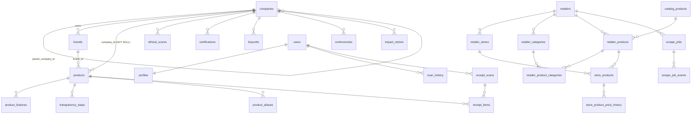

# Legacy schema summary

Readable companion to [`schema.sql`](schema.sql). Source: the legacy Supabase project (`chaidwvlizbayyugnphw`), read-only queries via the `supabase-legacy` MCP on 2026-10-26 (task P0.1). Database size: 14 MB.

## At a glance

| Object | Count | Notes |
|---|---|---|
| Tables (`public`) | 28 | RLS enabled on all 28 |
| Views | 2 | Neither sets `security_invoker` (see Security notes) |
| Functions (`public`) | 47 | 16 user-defined + 31 owned by `pg_trgm` (installed in `public`) |
| Policies | 27 | 13 tables have RLS on and **no** policy (service-role only) |
| Triggers | 20 | 19 on `public` tables, 1 on `auth.users` |
| Constraints | 79 | 28 PK, 3 UNIQUE, 10 CHECK, 38 FK |
| Indexes | 80 | 49 standalone + 31 backing PK/UNIQUE |
| Enums / sequences | 0 / 0 | Status fields are `text` + CHECK |
| Storage buckets | 0 | No storage used |
| Extensions | pg_trgm (public), pgcrypto, uuid-ossp, pg_stat_statements (extensions), pg_graphql, supabase_vault, plpgsql | |

Conventions: `uuid` PKs via `gen_random_uuid()`, `created_at`/`updated_at timestamptz default now()`, `updated_at` maintained by triggers. Ratings are text (`Good`/`Mixed`/`Poor`), grades are free text (`A+`…`F`), scores are integers 0–100.

## Domains

1. **Ethical catalogue** (editorial): `companies`, `brands`, `ethical_scores`, `certifications`, `boycotts`, `controversies`, `products`, `product_features`, `transparency_steps`, `product_aliases`, `impact_stories`.
2. **User data**: `profiles`, `scan_history`, `receipt_scans`, `receipt_items`, `community_submissions`.
3. **Config**: `app_settings`.
4. **Grocery catalogue / scraper** (Fortinos only): `retailers`, `retailer_stores`, `retailer_categories`, `catalog_products`, `retailer_products`, `retailer_product_categories`, `store_products`, `store_product_price_history`, `scrape_jobs`, `scrape_job_events`, `retailer_request_profiles`.

Note there is **no link** between the ethical `products` table and the grocery `catalog_products` table (D-008).

---

## Tables

RLS column legend: **public read** = `SELECT USING (true)` for role `public`; **own** = `auth.uid() = user_id` (or `id`); **none** = RLS on, no policies, so only the service role can read or write.

### Ethical catalogue

#### companies — 11 rows
- **Purpose:** a company with its overall ethical rating and profile facts.
- **Key columns:** `slug` (UNIQUE, NOT NULL), `company_name`, `legal_name`, `headquarters`, `founded int`, `public_or_private` (CHECK `Public|Private`), `stock_ticker`, `revenue_range`, `ceo`, `description`, `logo_url`, `overall_ethical_rating` (NOT NULL, CHECK `Good|Mixed|Poor`), `brands text[]` (denormalised list of brand names, kept in sync by the `brands_sync_company_array` trigger).
- **FKs:** `parent_company_id → companies` (no ON DELETE action). Self-referencing, single parent, no ownership share or dates.
- **Indexes:** trigram GIN on `company_name`.
- **RLS:** public read. No write policies.

#### brands — 49 rows
- **Purpose:** consumer-facing brand; `company_id` is the owner (table comment: "products inherit their company through their brand").
- **Key columns:** `name` (unique on `lower(name)`), `slug` (nullable, **not unique**), `company_id`, `logo_url`, `notes`.
- **FKs:** `company_id → companies ON DELETE SET NULL`.
- **Indexes:** `lower(name)` unique, `company_id`, trigram GIN on `name`.
- **Triggers:** `brands_touch_updated_at`; `brands_propagate_changes` (rename or owner change → updates `products.brand` / `products.company_id`); `brands_sync_company_array` (refreshes `companies.brands`).
- **RLS:** public read.

#### ethical_scores — 55 rows
- **Purpose:** per-company rating in one of 5 categories.
- **Key columns:** `category` (CHECK `environment|labour|animal_welfare|politics_and_tax|human_rights`), `rating` (CHECK `Good|Mixed|Poor`), `notes`. UNIQUE `(company_id, category)`.
- **FKs:** `company_id → companies ON DELETE CASCADE`.
- **No provenance:** no source URL, model, rubric version or confidence.
- **RLS:** public read.

#### certifications — 6 rows
- **Purpose:** certifications held by a company.
- **Key columns:** `name`, `verified bool`, `verified_date date`. No `created_at`/`updated_at`, no source.
- **FKs:** `company_id → companies ON DELETE CASCADE`.
- **RLS:** public read.

#### boycotts — 2 rows
- **Purpose:** boycott campaigns against a company.
- **Key columns:** `name`, `reason`, `status` (free text), `source_url`.
- **FKs:** `company_id → companies ON DELETE CASCADE`.
- **RLS:** public read.

#### controversies — 5 rows
- **Purpose:** news-style negative events for a company.
- **Key columns:** `title`, `date_text` (free-text date), `description`, `source_url`, `severity` (CHECK `low|medium|high|critical`).
- **FKs:** `company_id → companies ON DELETE CASCADE`.
- **RLS:** public read.

#### products — 13 rows
- **Purpose:** the ethical product catalogue (what the scanner and receipt matcher look up).
- **Key columns:** `name`, `barcode` (UNIQUE, nullable), `brand` (text, copied from `brands.name`), `brand_id`, `company_id` (NOT NULL), `category`, `ethical_score int` (CHECK 0–100), `grade` (free text), `certifications text[]`, `image_url`, `description`, `source` (default `manual`; other values come from the `lookup-product` edge function).
- **FKs:** `company_id → companies ON DELETE CASCADE`; `brand_id → brands ON DELETE SET NULL`.
- **Indexes:** `company_id`, `brand_id`, partial on `source <> 'manual'`, **two identical** trigram GIN indexes on `name` (`idx_products_name_trgm`, `products_name_trgm_idx`).
- **Triggers:** `products_inherit_from_brand` (BEFORE INSERT/UPDATE: copies brand name and company from `brand_id`), `trg_products_updated_at`.
- **RLS:** public read.

#### product_features — 30 rows
- **Purpose:** icon + title + description bullets shown on a product page.
- **Key columns:** `icon`, `title`, `description`, `sort_order`.
- **FKs:** `product_id → products ON DELETE CASCADE`.
- **RLS:** public read.

#### transparency_steps — 20 rows
- **Purpose:** ordered supply-chain steps shown on a product page.
- **Key columns:** `step_number`, `title`, `description`.
- **FKs:** `product_id → products ON DELETE CASCADE`.
- **RLS:** public read.

#### product_aliases — 0 rows
- **Purpose:** raw receipt strings known to mean a product; grown from admin corrections and used by `match_receipt_items`.
- **Key columns:** `alias` (unique on `lower(alias)`), `source` (default `manual`).
- **FKs:** `product_id → products ON DELETE CASCADE`.
- **Indexes:** trigram GIN on `alias`.
- **RLS:** none (service role only).

#### impact_stories — 6 rows
- **Purpose:** editorial stories/articles for the Stories screen.
- **Key columns:** `title`, `subtitle`, `category`, `body`, `cover_image_url`, `featured bool`, `published_at`.
- **FKs:** `company_id → companies` (nullable, no ON DELETE action).
- **Indexes:** `company_id`; `(featured, published_at DESC)`.
- **RLS:** public read. **Note:** unpublished rows (`published_at IS NULL`) are readable too; the policy doesn't filter.

### User data

#### profiles — 3 rows
- **Purpose:** one row per auth user.
- **Key columns:** `id` (= `auth.users.id`), `display_name`, `avatar_url`, `bio`, `member_since`. No `role` column; the legacy DB has no notion of admin.
- **FKs:** `id → auth.users ON DELETE CASCADE`.
- **Created by:** `on_auth_user_created` trigger → `handle_new_user()`.
- **RLS:** own SELECT and UPDATE. No INSERT (the trigger inserts) or DELETE.

#### scan_history — 13 rows
- **Purpose:** every barcode/QR/search/receipt event the user saved; drives history and stats.
- **Key columns:** `scan_type` (CHECK `barcode|qr|manual_search|receipt`), `product_name`, `ethical_score`, `grade`, `label`, `scanned_at`. Denormalised snapshot of the product at scan time.
- **FKs:** `user_id → auth.users ON DELETE CASCADE`; `product_id → products`, `company_id → companies` (no ON DELETE action, so deleting a scanned product fails).
- **Indexes:** `(user_id, scanned_at DESC)`.
- **RLS:** own SELECT/INSERT/UPDATE/DELETE.

#### receipt_scans — 9 rows
- **Purpose:** one scanned receipt (store, totals, trip rating).
- **Key columns:** `store_name` (free text, no store FK), `trip_rating`, `total_items`, `total_amount numeric(10,2)`, `scanned_at`.
- **FKs:** `user_id → auth.users ON DELETE CASCADE`; `scan_history_id → scan_history` (no action).
- **RLS:** own SELECT/INSERT/UPDATE/DELETE.

#### receipt_items — 80 rows
- **Purpose:** line items of a receipt, optionally matched to a product.
- **Key columns:** `product_name`, `price numeric(10,2)`, `grade`, `notes`. No quantity, size, raw line text or match confidence.
- **FKs:** `receipt_scan_id → receipt_scans ON DELETE CASCADE`; `scan_history_id → scan_history`; `product_id → products` (no action).
- **RLS:** own via `EXISTS (receipt_scans rs WHERE rs.user_id = auth.uid())` for SELECT/INSERT/DELETE. **No UPDATE policy.**

#### community_submissions — 6 rows
- **Purpose:** user-suggested companies or products, reviewed by admins.
- **Key columns:** `submission_type` (CHECK `company|product`), `status` (CHECK `pending|approved|rejected`), `data jsonb`, `reviewer_notes`, `reviewed_at`, `reviewed_by`.
- **FKs:** `user_id → auth.users` and `reviewed_by → auth.users`, **both without ON DELETE CASCADE** (deleting a user with submissions fails unless rows are removed first).
- **RLS:** own SELECT and INSERT; UPDATE/DELETE only while `status = 'pending'`.

### Config

#### app_settings — 4 rows
- **Purpose:** key/value JSON config read by the edge functions (e.g. OpenRouter model chains, per migrations `app_settings` and `enrichment_models`).
- **Key columns:** `key` (PK), `value jsonb`, `description`.
- **RLS:** none (service role only).

### Grocery catalogue / scraper

All 11 tables have RLS on and **no policies**: only the service role (catalog-worker and admin SPA) can reach them.

| Table | Rows | Purpose | Key columns / constraints | FKs |
|---|---|---|---|---|
| retailers | 1 | A retailer/source; `provider_key` picks the worker implementation | `provider_key` unique, `slug`, `country_code` (CA), `default_currency` (CAD), `configuration_json` | — |
| retailer_stores | 1 | A physical/online store | unique `(retailer_id, external_store_id)`, address fields, `latitude/longitude`, `timezone`, `last_successful_sync_at` | retailer CASCADE |
| retailer_categories | 2 | Retailer category tree | unique `(retailer_id, external_category_id)`, `parent_category_id`, `level`, `url_path`, `navid`, `last_product_count` | retailer CASCADE, parent SET NULL |
| catalog_products | 96 | Canonical grocery product identity | `upc` unique when not null, `normalized_name` (trgm), `brand` (text), `package_quantity`, `package_unit`, `package_size_text`, `product_match_status` (default `retailer_specific`) | — |
| retailer_products | 96 | A retailer's listing, mapped to a catalog product | unique `(retailer_id, external_product_id)`, `retailer_name` (trgm), `retailer_brand`, `product_url`, `raw_fingerprint`, `first_seen_at`/`last_seen_at`, `is_active`, `is_sponsored` | retailer CASCADE, catalog_product SET NULL |
| retailer_product_categories | 96 | Listing ↔ category | PK `(retailer_product_id, retailer_category_id)`, `is_primary` | both CASCADE |
| store_products | 96 | Current price/availability at a store | unique `(store_id, retailer_product_id)`, `regular/sale/member/effective_price`, `unit_price(+_quantity, _unit)`, `is_listed`, `is_available_online` (NULL = unknown), `promotion_*`, `source_checked_at`, `last_changed_at` | store CASCADE, retailer_product CASCADE |
| store_product_price_history | 96 | Append-on-change price history | `(store_product_id, observed_at DESC)` index; `scrape_job_id` **has no FK** | store_product CASCADE |
| scrape_jobs | 12 | Admin-queued ingestion job | `status` CHECK (8 states), progress and `products_*` counters, `heartbeat_at`, `claimed_by`, `retry_count`, `configuration_json` | retailer CASCADE, store SET NULL |
| scrape_job_events | 19 | Structured job log | `severity` (default `info`), `event_type`, `category_external_id`, `page`, `external_product_id`, `details_json` | job CASCADE |
| retailer_request_profiles | 0 | Sanitised replayable request templates | `provider_key`, `request_template_json`, `sanitized_headers_json`, `last_validated_at` | retailer CASCADE, store SET NULL |

Provenance in this domain is partial: `source_checked_at`, `first_seen_at`/`last_seen_at` and `scrape_job_id` exist, but there is no source URL per price, no parser version, and no raw-response storage.

---

## Views

| View | Purpose | Readable by |
|---|---|---|
| `company_details_view` | A company row plus JSON arrays of its `ethical_scores`, `certifications_list`, `active_boycotts` and `controversies_list`. Used by the company screen. | anon, authenticated |
| `user_stats_view` | Per-`user_id` totals from `scan_history`: `total_scans`, `brands_avoided` (distinct companies graded D-/D/D+/F), `ethical_choices` (score ≥ 60), `avg_score`. | anon, authenticated |

## Functions (16 user-defined)

| Function | Kind | Security | Purpose |
|---|---|---|---|
| `search_all(p_query, p_filter='all')` | RPC | invoker, `search_path=public,extensions` | ILIKE search over products (name/brand/barcode/company) and companies (name, brands table, legacy `brands[]`). 20 rows each. Returns `(id, type, name, subtitle, grade, rating)`. |
| `match_receipt_items(p_queries text[], p_limit=3)` | RPC | invoker, `search_path=public,extensions` | Receipt line → product candidates. Candidate sources, in score order: alias exact 1.0, barcode 0.99, name exact 0.98, brand+name exact 0.95, trigram fuzzy ×0.9 (sim > 0.25, word_sim > 0.5, brand+name > 0.3), alias fuzzy ×0.9 (> 0.35). Standalone numbers are stripped before fuzzy scoring. |
| `normalize_match_text(text)` | helper, IMMUTABLE | invoker | lower, `&`→`and`, non-alnum → space, collapse spaces. |
| `barcodes_match(a, b)` | helper, IMMUTABLE | invoker | Digits only, strip leading zeros, require ≥ 6 digits; equal, or equal apart from one trailing (check) digit. |
| `check_content_freshness(companies_since, products_since, stories_since)` | RPC | **definer** (no search_path set) | Returns `{companies_stale, products_stale, stories_stale}` for the app's offline cache. |
| `get_user_stats(p_user_id)` | RPC | **definer** (no search_path set) | Same numbers as `user_stats_view` for any user id passed in. |
| `handle_new_user()` | trigger fn | **definer** (no search_path set) | Inserts a `profiles` row from `raw_user_meta_data` (`display_name` → `full_name` → `'User'`, `avatar_url`). |
| `claim_scrape_job(worker_id, stale_before)` | RPC (worker) | invoker | Atomically claims the oldest queued job, or a stale running/claiming one (`FOR UPDATE SKIP LOCKED`); bumps `retry_count` on reclaim. |
| `request_scrape_job_cancel(p_id)` | RPC (admin) | invoker | queued → cancelled; running/claiming → cancelling. |
| `products_inherit_from_brand()` | trigger fn | invoker | See products. |
| `brands_propagate_changes()` | trigger fn | invoker | See brands. |
| `brands_sync_company_array()` | trigger fn | invoker | Calls `refresh_company_brands_array` for the old and new company. |
| `refresh_company_brands_array(p_company)` | helper | invoker | Rebuilds `companies.brands` from `brands`. |
| `set_updated_at()`, `touch_updated_at()`, `app_settings_touch_updated_at()` | trigger fns | invoker | Three identical `updated_at = now()` functions (the last two have byte-identical bodies). |

The other 31 functions in `public` are `pg_trgm`'s (`similarity`, `word_similarity`, `show_trgm`, GIN/GiST support, etc.), because the extension was installed into `public` rather than `extensions`.

## Triggers

| Table | Trigger | When | Function |
|---|---|---|---|
| auth.users | on_auth_user_created | AFTER INSERT | handle_new_user |
| brands | brands_propagate_changes | AFTER UPDATE | brands_propagate_changes |
| brands | brands_sync_company_array | AFTER INSERT/UPDATE/DELETE | brands_sync_company_array |
| products | products_inherit_from_brand | BEFORE INSERT/UPDATE | products_inherit_from_brand |
| app_settings, boycotts, brands, catalog_products, companies, ethical_scores, impact_stories, products, profiles, retailer_categories, retailer_products, retailer_request_profiles, retailer_stores, retailers, scrape_jobs, store_products | (16 `*_updated_at` triggers) | BEFORE UPDATE | set_updated_at / touch_updated_at / app_settings_touch_updated_at |

Tables with an `updated_at` column but **no** trigger: none. Tables without `updated_at`: certifications, controversies, product_features, transparency_steps, product_aliases, scan_history, receipt_*, community_submissions, retailer_product_categories, store_product_price_history, scrape_job_events.

## Storage

No buckets (`storage.buckets` is empty) and no storage policies. Receipt images were not persisted server-side.

---

## Security notes (for the rebuild, not fixes to legacy)

1. **`user_stats_view` leaks every user's stats.** It runs with owner rights (no `security_invoker`), so it bypasses `scan_history` RLS, and `anon` has SELECT. Anyone with the anon key can list all `user_id`s with their scan counts and average score.
2. **`get_user_stats(p_user_id)` is SECURITY DEFINER and takes any user id.** Same leak via RPC, and executable by `anon`.
3. **`company_details_view`** also bypasses RLS, but its underlying tables are public read, so nothing extra leaks.
4. The three SECURITY DEFINER functions don't pin `search_path` (Supabase advisor `function_search_path_mutable`).
5. No admin role in the DB. All admin writes depended on the service-role key, which the admin SPA held in the browser (see PROGRESS 2026-10-26).
6. `pg_trgm` is installed in `public` (advisor `extension_in_public`).
7. Policies are granted `TO public` rather than `TO authenticated`; the `auth.uid()` checks make this safe for own-row policies.

## Drift: migrations vs. live DB

The live migration history (`list_migrations`) has 9 entries; `LEGACY/supabase/migrations/` has 11 files.

| Item | In repo files | In live history | In live DB | Notes |
|---|---|---|---|---|
| Base schema: profiles, companies, ethical_scores, certifications, boycotts, controversies, products, product_features, transparency_steps, impact_stories, scan_history, receipt_scans, receipt_items, community_submissions (14 tables), both views, `handle_new_user`, `set_updated_at`, `get_user_stats`, 26 of the 27 RLS policies, and their indexes | **No** | No | Yes | Created before migrations were tracked (dashboard/SQL editor). No file in the legacy repo contains `create table ... companies`. **`schema.sql` is the only record of these.** |
| `pg_trgm` extension | No | No | Yes | Used by the trigram indexes and the matcher. |
| `20260711120000_app_settings` … `20260716140000_retailer_catalog_fortinos_fields` (9 files) | Yes | Yes | Yes | Match. |
| `20260806120000_delete_own_account` (`delete_own_account()` RPC) | Yes | **No** | **No** | Never applied. The legacy app's account-deletion call would fail against the live DB. |
| `20260806130000_check_content_freshness` | Yes | **No** | Yes | Function exists in the DB, but the migration isn't recorded: applied by hand. |
| `products.brand`, `brand_id`, `source` columns | Yes (ALTERs) | Yes | Yes | Appear at the end of the `products` column list, as expected from ALTERs. |

Fourteen of the 28 tables are created by tracked migrations (`app_settings`, `brands`, `product_aliases`, and the 11 catalogue/scraper tables); the other 14 exist only in the live DB.

## Row counts (exact, 2026-10-26)

| Table | Rows | Table | Rows |
|---|---|---|---|
| app_settings | 4 | receipt_scans | 9 |
| boycotts | 2 | retailer_categories | 2 |
| brands | 49 | retailer_product_categories | 96 |
| catalog_products | 96 | retailer_products | 96 |
| certifications | 6 | retailer_request_profiles | 0 |
| community_submissions | 6 | retailer_stores | 1 |
| companies | 11 | retailers | 1 |
| controversies | 5 | scan_history | 13 |
| ethical_scores | 55 | scrape_job_events | 19 |
| impact_stories | 6 | scrape_jobs | 12 |
| product_aliases | 0 | store_product_price_history | 96 |
| product_features | 30 | store_products | 96 |
| products | 13 | transparency_steps | 20 |
| profiles | 3 | receipt_items | 80 |
